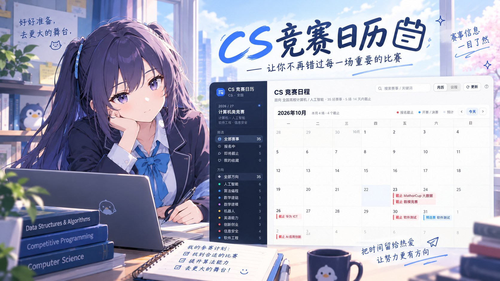

# CS 竞赛日历

计算机、人工智能、软件工程、信息安全专业能打的比赛，按时间排成一张日历。一个 `index.html`，没有构建，扔到 GitHub Pages 就能用。


在线版：<https://centamatcha.github.io/cs-competition-calendar/>　源码：<https://github.com/CentaMatcha/cs-competition-calendar>


## 为什么做这个

比赛信息散在官网、赛氪、学院群和教务处通知里，同一场比赛经常给出不同的日期，还有不少已经过期。我想要的只是一张能按月看、点开有来源的日历，找不到，就自己整理了一份。

## 收了哪些

39 场，九个方向：

| 方向 | 数量 | 代表赛事 |
|---|---:|---|
| 人工智能 | 8 | 华为 ICT、数媒竞赛、传智杯、计算机设计大赛、大数据挑战赛、腾讯广告算法、讯飞 1024 |
| 算法编程 | 7 | ICPC / CCPC、蓝桥杯、天梯赛、华为软挑、百度之星、中兴捧月 |
| 数学建模 | 5 | 美赛、国赛、APMCM、MathorCup 大数据、统计建模 |
| 软件工程 | 5 | 软件测试大赛、中国软件杯、移动应用创新赛、物联网设计竞赛、开源之夏 |
| 信息安全 | 4 | 信安作品赛、信安实践赛、强网杯、ISCC |
| 英语能力 | 3 | NECCS、21 世纪杯、外研社·国才杯 |
| 创新创业 | 3 | 创新大赛、挑战杯、服务外包 |
| 机器人 | 3 | 智能汽车、睿抗 RAICOM、RoboMaster |
| 数学基础 | 1 | 全国大学生数学竞赛 |

39 场里只有 10 场的日期是主办方公布的，另外 29 场按往年时间推算，卡片上标「预计 · 待官宣」。报名前点一下来源链接核对，官网和校内通知的日期经常不是一回事。


## 怎么用

月历看这个月要截止什么，议程看完整清单。红色是报名截止，彩色是开赛或决赛。

点开任何一场，能看到报名窗口、参赛形式、是官网直报还是走校内选拔，加上两三条备赛建议。单场或全部都能导出 `.ics`。

备注和收藏存在浏览器本地，不上传，换台设备就没了。

## 本地打开和部署

clone 下来直接双击 `index.html` 就能用；起个静态服务器也行：

```bash
python3 -m http.server 8000   # http://localhost:8000
```

部署到 Pages：仓库 Settings → Pages → Deploy from a branch → `main` / `(root)`。根目录已经有 `.nojekyll`，不需要构建。

## 数据是哪来的

来源主要是这几处：

- 赛事官网：华为 ICT、蓝桥杯、COMAP、CUMCM、计算机设计大赛、挑战杯、智能汽车、天梯赛、RAICOM、服务外包、NECCS、21 世纪杯、外研社·国才杯、统计建模。
- 赛氪：APMCM、MathorCup 大数据、NECCS 分赛区。
- 高校教务处通知：华为 ICT（西安交大）、蓝桥杯（重庆交大）、传智杯（西安交大）、外研社·国才杯（四川大学）、AI 应用创新（华南农大）。
- 部委和学会：中国信息安全测评中心、中国网信网、CCF 软件工程专委会、工信部、中科院软件所。
- 高校院系：浙江大学、上海交大、北理工 ISCC。

仓库里不放赛事 Logo，也不代替官方报名。

## 更新数据

`data/feed.latest.json` 是默认在线源。页面启动时读一次，读不到就用内置数据；右上角「更新」也会先读它。

改这个文件、推到 `main`，下次打开或点更新就是新的，不用改代码，也不用重新部署。

```json
{
  "version": "2028.03.01.1",
  "updatedAt": "2028-03-01",
  "notice": "2028 赛季更新：新增挑战杯、CCPC 分站赛时间",
  "events": [{ "id": "lanqiao2028", "regEnd": "2028-03-10", "confidence": "confirmed" }],
  "remove": ["math2026"]
}
```

`events` 按 `id` 合并，只写要改的字段；新 `id` 就是新增一场。`remove` 填要下架的 `id`。`version` 用 `YYYY.MM.DD.N`，不能小于当前内置版本，否则缓存会被判成过期丢掉。

`cat` 可选 `ai` / `algo` / `math` / `modeling` / `robot` / `english` / `innovation` / `security` / `engineering`；`confidence` 只有 `confirmed` 和 `expected`，日期没公布别写 `confirmed`。

也可以在更新面板填一个允许跨域的 JSON 地址，或者直接导入文件。完整示例见 [`data/feed.example.json`](data/feed.example.json)。


## 维护

`updatedAt` 超过 120 天，页面顶部会提示数据过期。`.github/workflows/data-check.yml` 每月 1 日跑一次，超过 180 天就在 Issues 里开一条带修法的 issue 并指派给我；已经开过就只追加评论。

每年 3 月和 9 月各更新一次，正好对上春季赛报名和秋季赛、次年美赛。

## 已知问题

- 29 场是推算日期，官方一公布就得改，我没法保证每条都及时。
- 中兴捧月、华为软件精英挑战赛的链接目前指向新闻报道，这两家的赛事入口每年换域名，还没找到稳定的。
- 数据靠人工维护，没有爬虫。GitHub 会在仓库 60 天没提交后停掉定时任务，这时候提醒也会跟着失效。

## 贡献

补赛事、改日期、改界面都欢迎。动手前看一眼 [`CONTRIBUTING.md`](CONTRIBUTING.md)，主要三条：

- 给出来源链接，官网、赛氪、高校通知都行。
- 日期不确定就标 `expected`，别凑一个精确日期。
- 不收付费答题、付费拿证、没有主办方的比赛。

## 作者

CentaMatcha · <https://github.com/CentaMatcha>

数据和页面都是一个人在做。发现日期变了、赛事漏了，或者想加本校的校内赛，直接提 issue 或 PR，带上官网或教务处链接。

## 免责声明

这是一个个人维护的信息汇总页，不是官方报名入口。

- 日期、赛制、报名方式来自赛事官网、赛氪和高校教务处通知。整理或转载过程中可能过期、抄错，报名前请核对主办方和本校教务处的最新通知。
- 标着「预计」的赛事，日期按往年推算，官方还没公布。
- 因为参考本日历而错过报名、报错赛区或者产生其他损失，我不承担责任。
- 与赛氪、我爱竞赛网以及任何赛事主办方都没有隶属或合作关系。赛事名称、规则、日期和 Logo 归各主办方所有。
- 页面里的站外链接指向第三方，那些页面的内容由对方负责。

## License

代码 MIT，见 [`LICENSE`](LICENSE)；数据整理按 CC BY 4.0。

这个项目最早是一个自用的 AI 竞赛日历，后来整理成不依赖特定学校的版本。
