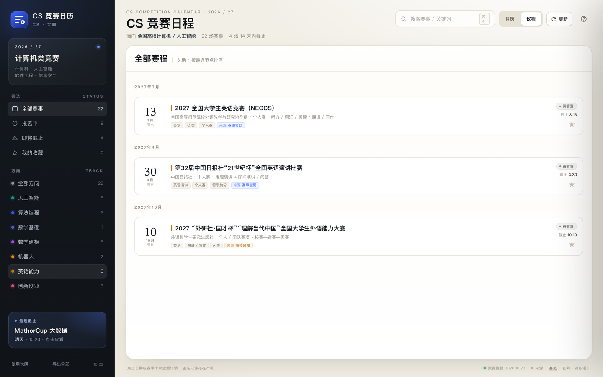

# CS 竞赛日历

> 面向全国高校 **计算机 / 人工智能 / 软件工程 / 信息安全** 专业的精选竞赛日历。  
> 单页应用、零安装、可部署到 GitHub Pages；支持月历 / 议程、备注、收藏、ICS 导出和可更新数据源。


**在线版**：<https://centamatcha.github.io/cs-competition-calendar/>（部署到 GitHub Pages 后生效） · **源码**：<https://github.com/CentaMatcha/cs-competition-calendar>


## 这个项目解决什么问题

计算机专业的竞赛信息散落在赛事官网、赛氪、高校教务处通知和公众号里：有的只写“4 月”，有的报名已经截止，有的需要校内选拔。这个项目把**对计算机 / AI 专业真正有用的赛事**整理成一张可筛选、可备注、可导出的日历，而不是再做一个大而全的信息站。

- **35 场精选赛事**，覆盖 AI、算法、数学建模、机器人、英语、创新创业、信息安全、软件工程。
- **只有 10 场是已确认日期**，其余 25 场明确标注“预期 / 待官宣”，不把推算日期伪装成官方日期。
- **每场赛事都有来源**：赛事官网、赛氪或高校通知，详情页可直接跳转核对。
- **单页应用，无后端、无构建、无追踪**；打开 `index.html` 就能用。
- **数据可以更新**：应用内 `update-feed.js`、在线 JSON、导入文件三种方式。



## 功能

- **月历 / 议程**：红色是报名截止，彩色是开赛 / 决赛；支持月份切换与“今天”。
- **赛事详情**：报名窗口、比赛时间、参赛形式、报名方式、关键节点、报名提示、备赛建议。
- **我的备注**：每场赛事可写组队、导师、材料进度，自动保存在本机。
- **收藏 / 搜索 / 分类筛选**：按方向、状态、关键词筛选。
- **导出 `.ics`**：单场或全部赛事导入系统日历。
- **来源标识**：每场显示“来源 · 赛事官网 / 赛氪 / 高校通知”，详情底部保留原始链接。
- **更新源**：右上角“更新”可检查 `update-feed.js` 或在线 JSON；支持导入文件和恢复内置。
- **响应式**：桌面、平板和手机浏览器都能用；macOS / Windows 可用 Edge 独立窗口打开。

## 快速开始

### 方式一：GitHub Pages（推荐）

1. 把本目录推到 GitHub 仓库。
2. 打开仓库 **Settings → Pages**。
3. **Build and deployment → Deploy from a branch**，选择 `main` / `(root)`。
4. 访问 https://centamatcha.github.io/cs-competition-calendar/

`index.html` 在根目录，不需要任何构建步骤。

### 方式二：本地打开

```bash
# macOS
open index.html

# Windows
start index.html
```

也可以直接用 Edge 的独立窗口：

```bash
# macOS
"/Applications/Microsoft Edge.app/Contents/MacOS/Microsoft Edge" \
  --app="file:///absolute/path/to/index.html"

# Windows PowerShell
& "$env:ProgramFiles(x86)\Microsoft\Edge\Application\msedge.exe" `
  --app="file:///C:/path/to/index.html"
```

## 数据覆盖

| 方向 | 数量 | 代表赛事 |
|---|---:|---|
| 人工智能 | 5 | 华为 ICT、AI 应用创新、数媒竞赛、传智杯、计算机设计大赛 |
| 算法编程 | 3 | 蓝桥杯、天梯赛、ICPC / CCPC |
| 数学基础 | 1 | 全国大学生数学竞赛 |
| 数学建模 | 5 | 美赛、国赛、APMCM、MathorCup 大数据、统计建模 |
| 机器人 | 3 | 智能汽车、睿抗 RAICOM、RoboMaster |
| 英语能力 | 3 | NECCS、21 世纪杯、外研社·国才杯 |
| 创新创业 | 3 | 创新大赛、挑战杯、服务外包 |
| 信息安全 | 4 | 信安作品赛、信安创新实践能力赛、强网杯、ISCC |
| 软件工程 | 5 | 软件测试大赛、中国软件杯、移动应用创新赛、物联网设计竞赛、开源之夏 |

**总计 35 场：10 场已确认 + 25 场预期。** 预期赛事均在详情中注明“待官宣”，报名前请以官网为准。

### 数据来源

- 赛事官网：华为 ICT、蓝桥杯、COMAP、CUMCM、计算机设计大赛、挑战杯、智能汽车、天梯赛、RAICOM、服务外包、NECCS、21 世纪杯、外研社·国才杯、统计建模等。
- 赛氪：APMCM、MathorCup 大数据、NECCS 分赛区等。
- 信息安全：中国信息安全测评中心 / 教指委（信安作品赛、创新实践能力赛）、中国网信网（强网杯）。
- 软件工程：CCF 软件工程专委会（软件测试大赛）、工信部（中国软件杯）、浙江大学（移动应用创新赛）、上海交大（物联网设计竞赛）、中科院软件所（开源之夏）。
- 高校教务处通知：华为 ICT（西安交大）、蓝桥杯（重庆交大）、传智杯（西安交大）、外研社·国才杯（四川大学）、AI 应用创新（华南农大 / 电子科大）等。

每场赛事的详情页底部都有来源链接；本仓库不存储赛事 Logo，不代替官方报名。

## 长期维护（每年两次）

应用内置的只是快照，真正让「更新」长期有效的是仓库里的 `data/feed.latest.json`：

- 应用启动时会静默拉一次这个文件，拉不到就用内置数据，不会报错；
- 用户点右上角「更新」时，也会先读它，读不到再退回 `update-feed.js`；
- 所以**每年只要改这一个 JSON 并推送**，所有用户下一次打开或点更新就是最新赛历，不用改代码、不用发版。

维护节奏建议：每年 **3 月**（春季赛报名）和 **9 月**（秋季赛 + 次年美赛）各更新一次。

### 自动提醒

`.github/workflows/data-check.yml` 每月 1 日 09:00（北京时间）跑一次，也可以在 Actions 页面手动触发：读 `data/feed.latest.json` 的 `updatedAt`，超过 180 天就在 Issues 里开一条带操作清单的 issue 并指派给仓库所有者；已经有同类 issue 时只在原 issue 下追加评论，不会刷屏。

注意：GitHub 会在仓库 60 天没有提交后停用定时任务（停用时会发邮件通知），所以按时更新数据本身也是让这个提醒保持存活的方式。

```json
{
  "version": "2028.03.01.1",
  "updatedAt": "2028-03-01",
  "notice": "2028 赛季更新：新增挑战杯、CCPC 分站赛时间",
  "events": [{ "id": "lanqiao2028", "regEnd": "2028-03-10", "confidence": "confirmed" }],
  "remove": ["math2026", "mocom2026"]
}
```

注意：

- `version` 用 `YYYY.MM.DD.N` 且**不要小于当前内置版本**，否则缓存会被判定过期丢弃；
- 赛季结束的赛事记得写进 `remove`，日历才不会越攒越乱；
- 数据日期超过 120 天，页面顶部会自动提示"数据已 N 天未更新"。

## 更新数据

右上角“更新”有三条路径：

1. **本地更新源**：修改 `update-feed.js`，再点“更新”。适合自己维护一个 fork。
2. **在线 JSON**：在更新面板填入一个可跨域访问的 JSON 地址。适合把数据放到 GitHub Pages、GitHub raw 或自己的静态服务器。
3. **导入文件**：手动选择 `.json` 更新文件；也可以“恢复内置”。

更新 JSON 格式：

```json
{
  "version": "2026.11.01.1",
  "updatedAt": "2026-11-01",
  "notice": "本次更新说明",
  "events": [
    {
      "id": "example2027",
      "title": "赛事名称",
      "cat": "algo",
      "regEnd": "2027-03-01",
      "contestStart": "2027-04-01",
      "link": "https://example.com"
    }
  ],
  "remove": ["要删除的赛事 id"]
}
```

- `events` 里只写要改的字段即可；`id` 已存在则合并，不存在则新增。
- `cat`：`ai` / `algo` / `math` / `modeling` / `robot` / `english` / `innovation` / `security` / `engineering`。
- `confidence`：`confirmed` 或 `expected`；预期日期不要写成已确认。
- `link` 必须是 `http(s)` 地址。
- 在线源必须允许 CORS。

示例文件见 [`data/feed.example.json`](data/feed.example.json)。


## 与已有项目的区别

上传前我检索了 GitHub 上相近的项目。**没有发现完全相同的“面向全国计算机专业的单页竞赛日历”**，但通用赛道已有成熟项目，建议先看清差异再决定是否重复造轮子：

| 项目 | 定位 | 与本项目的关系 |
|---|---|---|
| [hhx-gg/campus-competitions](https://github.com/hhx-gg/campus-competitions) | Windows 桌面端（Tauri + React + Cloudflare Workers），约 450 条记录、150 所高校、每日自动更新、MIT | **最接近的同类项目**。如果你要“大而全 + 自动抓取 + Windows 安装包”，优先用它或参与贡献；本项目刻意做小，专注 CS / AI 精选和 Web 零安装 |
| [ccfddl/ccf-deadlines](https://github.com/ccfddl/ccf-deadlines) | CCF 会议截稿日历，9k+ stars | 面向科研论文投稿，不是学生学科竞赛 |
| [nadiriyesteinmeier-cell/fzu-competition-radar](https://github.com/nadiriyesteinmeier-cell/fzu-competition-radar) | 福州大学竞赛雷达，185 项校内认定目录 | 学校特定，不是全国计算机专业通用 |
| [KrisDen2005/Contest](https://github.com/KrisDen2005/Contest) | 仓库名为“大学生竞赛日历” | 目前基本为空（仅 README），没有可复用的实现；本项目没有使用该名称 |
| [MaoMaoXia1238/cp-calendar](https://github.com/MaoMaoXia1238/cp-calendar) | 聚合 Codeforces / 洛谷 / 牛客等线上比赛 | 偏线上算法赛，不覆盖高校学科竞赛 |
| [b8l8u8e8/OnlineContestFetcher](https://github.com/b8l8u8e8/OnlineContestFetcher) | 线上算法竞赛聚合 + ICS / Pages | 同样是线上赛方向，不是计算机专业竞赛日历 |

**本项目的差异点：**

- **Web-first**：单页、零安装，GitHub Pages 即开即用；不绑定 Windows。
- **CS / AI 垂直**：不是“所有大学生比赛”，只收计算机专业真正会打的赛事。
- **精选而非穷举**：35 场，带“是否值得打 / 怎么准备 / 校内还是官网报名”的判断。
- **英语与衍生赛道**：NECCS、21 世纪杯、外研社·国才杯，适合英文授课 / 留学方向。
- **来源透明 + 更新源**：每条有来源链接，数据可增量更新，不假装实时爬虫。
- **备注 / 收藏 / ICS**：面向个人备赛，不是资讯展示页。

如果你更想要“全国所有高校、所有竞赛、自动每日更新”，请直接使用 `campus-competitions`；如果你想维护一个**轻量、可读、可改、专注 CS/AI** 的版本，这个项目才有独立价值。

## 贡献

欢迎 PR 补充赛事，但请先读 [`CONTRIBUTING.md`](CONTRIBUTING.md)：

- 必须给出来源链接（官网 / 赛氪 / 高校通知）。
- 不确定的日期标 `expected`，不要伪造精确日期。
- 不收录付费答题、付费拿证、无官方主办方的“水赛”。
- 不写学校特定备注；用通用的 `schoolNote` 描述“是否需要校内选拔 / 学校统一报名”。
- 新增赛事后至少检查：月历、议程、详情、ICS 导出。

## 发布到 GitHub

```bash
cd cs-competition-calendar

git init
git add .
git commit -m "feat: CS competition calendar"
git branch -M main

# 在 GitHub 新建空仓库 cs-competition-calendar，然后：
git remote add origin git@github.com:CentaMatcha/cs-competition-calendar.git
git push -u origin main
```

建议仓库信息：

- **名称**：`cs-competition-calendar`（不要用“大学生竞赛日历”，避免和已有空仓库重名）
- **描述**：`面向计算机/AI专业的精选竞赛日历 · 单页、零安装、GitHub Pages`
- **Topics**：`competition-calendar` `computer-science` `artificial-intelligence` `github-pages` `china` `students`

## 作者

**CentaMatcha** · [github.com/CentaMatcha](https://github.com/CentaMatcha)

赛事数据、页面实现和更新源都是一个人维护的。发现日期变了、赛事漏了，或者想加一所学校的校内赛，欢迎直接提 issue 或 PR——带上官网 / 教务处通知链接就行。

## License

- **代码**：MIT，见 [`LICENSE`](LICENSE)。
- **数据整理**：CC BY 4.0；赛事名称、规则、日期、Logo 归各主办方所有。
- 本项目与赛氪、我爱竞赛网及任何赛事主办方无隶属关系；日期可能调整，报名前请以官方通知为准。

## 说明

这个项目最初是一个个人自用的 AI 竞赛日历，后来整理成不依赖特定学校的通用版。个人版不包含在本仓库中；这里的 `schoolNote` 都是通用的“本校报名提示”，适用于全国高校学生。
