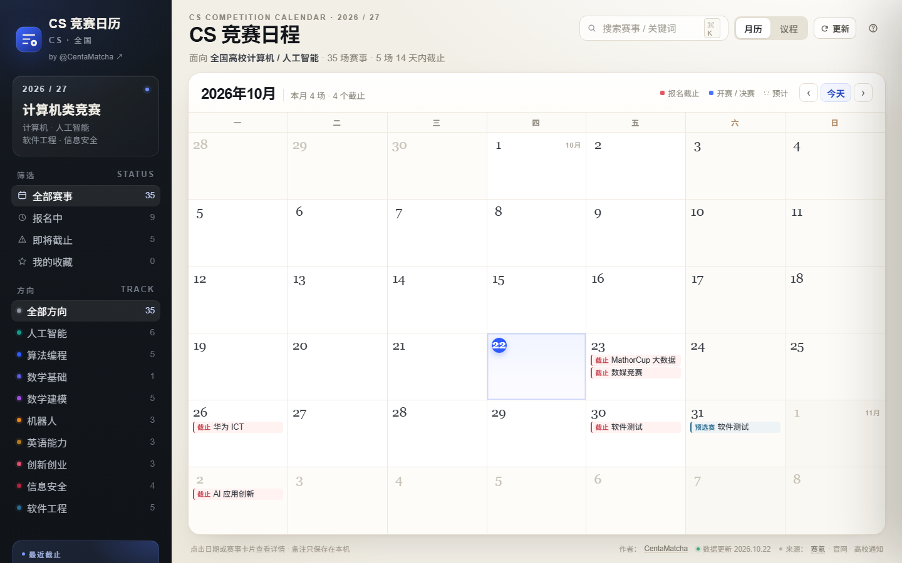
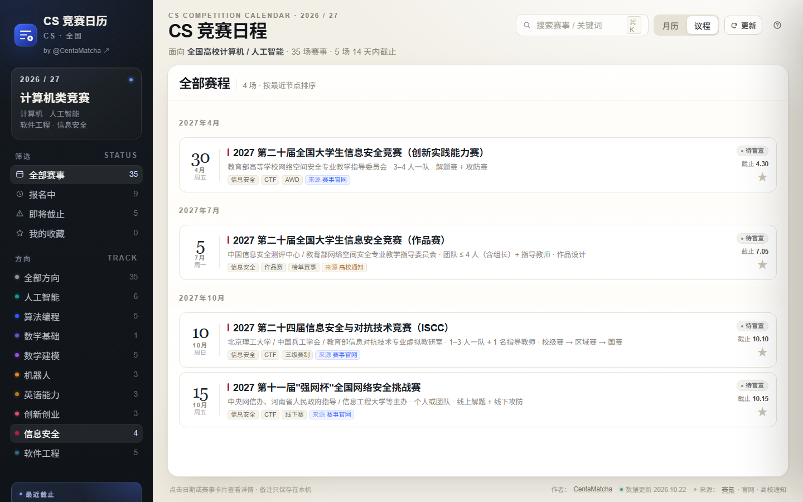
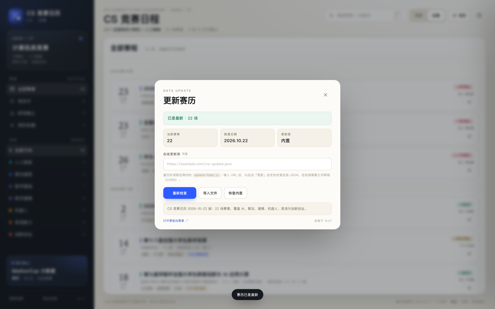

# CS 竞赛日历

面向计算机、人工智能、软件工程、信息安全专业的竞赛日历。单页应用，一个 `index.html`，放到 GitHub Pages 就能用。


在线版：<https://centamatcha.github.io/cs-competition-calendar/>　源码：<https://github.com/CentaMatcha/cs-competition-calendar>



## 里面有什么

39 场比赛，分九个方向：

| 方向 | 数量 | 代表赛事 |
|---|---:|---|
| 人工智能 | 8 | 华为 ICT、数媒竞赛、传智杯、计算机设计大赛、大数据挑战赛、腾讯广告算法、讯飞 1024 |
| 算法编程 | 7 | ICPC / CCPC、蓝桥杯、天梯赛、华为软挑、百度之星、中兴捧月 |
| 数学建模 | 5 | 美赛、国赛、APMCM、MathorCup 大数据、统计建模 |
| 软件工程 | 5 | 软件测试大赛、中国软件杯、移动应用创新赛、物联网设计竞赛、开源之夏 |
| 信息安全 | 4 | 信安作品赛、信安实践赛、强网杯、ISCC |
| 英语能力 | 3 | NECCS、21 世纪杯、外研社·国才杯 |
| 创新创业 | 3 | 创新大赛、挑战杯、服务外包 |
| 机器人 | 3 | 智能汽车、睿抗 RAICOM、RoboMaster |
| 数学基础 | 1 | 全国大学生数学竞赛 |

日期分两档。10 场是主办方已经公布的，另外 25 场按往年时间推算，卡片上标「预计 · 待官宣」。每场都留了来源链接，报名前点过去核一遍，官网日期和校内通知经常对不上。



## 怎么用

- 月历看截止日期，议程看完整清单。红色是报名截止，彩色是开赛或决赛。
- 点开卡片能看到报名窗口、参赛形式、是官网直报还是走校内选拔，以及两三条备赛建议。
- 备注、收藏、搜索都在本机浏览器里，不上传。
- 单场赛事或全部赛事都能导出 `.ics`，导进系统日历。

## 快速开始

把仓库 clone 下来，直接用浏览器打开 `index.html`；也可以起个静态服务器：

```bash
python3 -m http.server 8000   # http://localhost:8000
```

部署到 GitHub Pages：仓库 Settings → Pages → Deploy from a branch → `main` / `(root)`。根目录已有 `.nojekyll`，不需要构建。

想当作独立窗口用，可以走 Edge 的 `--app` 模式：

```bash
# Windows PowerShell
& "$env:ProgramFiles(x86)\Microsoft\Edge\Application\msedge.exe" `
  --app="file:///C:/path/to/index.html"
```

## 数据从哪来

- 赛事官网：华为 ICT、蓝桥杯、COMAP、CUMCM、计算机设计大赛、挑战杯、智能汽车、天梯赛、RAICOM、服务外包、NECCS、21 世纪杯、外研社·国才杯、统计建模。
- 赛氪：APMCM、MathorCup 大数据、NECCS 分赛区。
- 信息安全：中国信息安全测评中心（信安作品赛、创新实践能力赛）、中国网信网（强网杯）、北理工 ISCC 官网。
- 软件工程：CCF 软件工程专委会（软件测试大赛）、工信部（中国软件杯）、浙江大学（移动应用创新赛）、上海交大（物联网设计竞赛）、中科院软件所（开源之夏）。
- 高校教务处通知：华为 ICT（西安交大）、蓝桥杯（重庆交大）、传智杯（西安交大）、外研社·国才杯（四川大学）、AI 应用创新（华南农大）。

仓库里不放赛事 Logo，也不代替官方报名。

## 更新数据

仓库里的 `data/feed.latest.json` 是默认在线源。页面启动时读一次，读不到就用内置数据；右上角「更新」也会先读它。

改这个文件、推到 `main`，用户下次打开或点更新就拿到新数据，不用改代码，也不用重新部署。

```json
{
  "version": "2028.03.01.1",
  "updatedAt": "2028-03-01",
  "notice": "2028 赛季更新：新增挑战杯、CCPC 分站赛时间",
  "events": [{ "id": "lanqiao2028", "regEnd": "2028-03-10", "confidence": "confirmed" }],
  "remove": ["math2026"]
}
```

`events` 里按 `id` 合并，只写要改的字段；新 `id` 会新增一场。`remove` 填要下架的 `id`。`version` 用 `YYYY.MM.DD.N`，不能小于当前内置版本，否则缓存会被判为过期丢掉。

`cat` 可选 `ai` / `algo` / `math` / `modeling` / `robot` / `english` / `innovation` / `security` / `engineering`；`confidence` 只有 `confirmed` 和 `expected` 两种，日期没公布就别写 `confirmed`。

也可以在更新面板里填一个允许跨域的 JSON 地址，或者直接导入 JSON 文件。完整示例见 [`data/feed.example.json`](data/feed.example.json)。



## 维护

`updatedAt` 超过 120 天，页面顶部会提示数据过期。`.github/workflows/data-check.yml` 每月 1 日检查一次，超过 180 天就在 Issues 里开一条带修法的 issue 并指派给仓库所有者；已有同类 issue 时只追加评论。

建议每年 3 月和 9 月各更新一次，正好对上春季赛报名和秋季赛、次年美赛的时间。GitHub 会在仓库 60 天无提交后停用定时任务，所以按时更新数据本身也是在保这个提醒。

## 贡献

补赛事、改日期、改界面都欢迎。动手前先看 [`CONTRIBUTING.md`](CONTRIBUTING.md)，主要三条：

- 给出来源链接，官网、赛氪、高校通知都行。
- 日期不确定就标 `expected`，不要凑一个精确日期。
- 不收付费答题、付费拿证、没有主办方的比赛。

## 作者

CentaMatcha · <https://github.com/CentaMatcha>

数据和页面都是一个人维护的。发现日期变了、赛事漏了，或者想加本校的校内赛，直接提 issue 或 PR，带上官网或教务处链接。

## License

代码 MIT，见 [`LICENSE`](LICENSE)。数据整理按 CC BY 4.0；赛事名称、规则、日期和 Logo 归各主办方所有。

这个项目最初是一个自用的 AI 竞赛日历，后来整理成不依赖特定学校的版本。`schoolNote` 里写的都是通用的校内报名提示。
